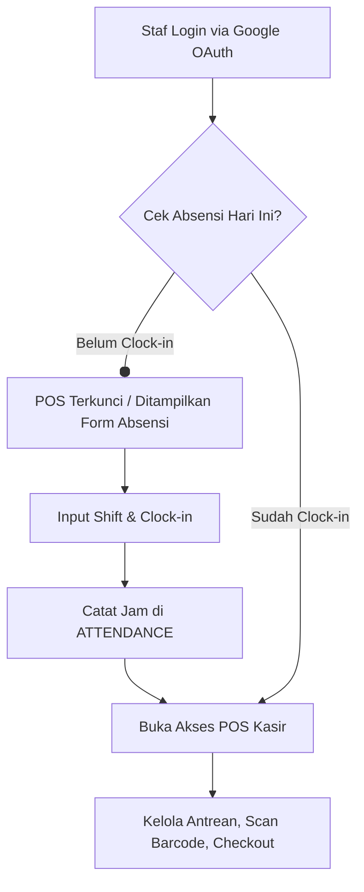
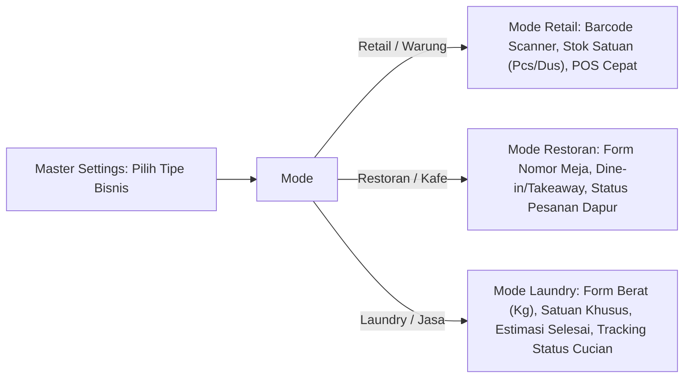
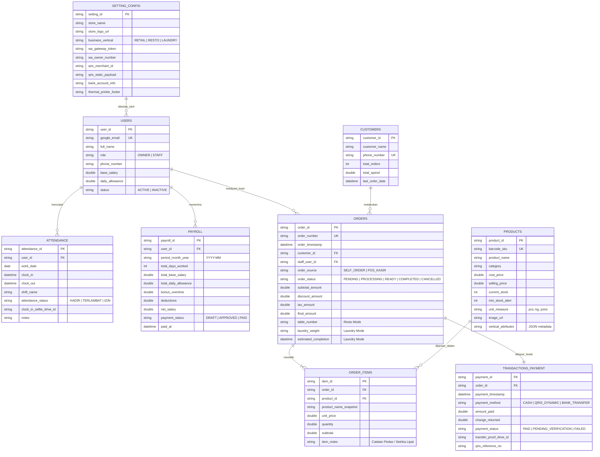

# Product Requirements Document (PRD)
## RASH Mitra — Mini ERP & POS Multi-Vertikal Berbasis Google Workspace

---

### Dokumen Kontrol
- **Nama Produk:** RASH Mitra (Mini ERP & POS Solution)
- **Pengembang:** RASH WebApp Builder
- **Versi Dokumen:** 1.0.0
- **Status:** Final Draft
- **Target Platform:** Google Apps Script (GAS) Web App + Google Sheets & Drive
- **Model Distribusi:** Standalone Instance (Lifetime License / Sekali Bayar)

---

## 1. Ringkasan Eksekutif
**RASH Mitra** adalah solusi Mini Enterprise Resource Planning (ERP) dan Point of Sale (POS) terpadu yang dirancang khusus untuk memenuhi kebutuhan operasional harian Usaha Mikro, Kecil, dan Menengah (UMKM). Dibangun di atas infrastruktur Google Workspace (Google Apps Script, Google Sheets, dan Google Drive), RASH Mitra mendemokratisasi digitalisasi bisnis dengan mengeliminasi beban biaya sewa perangkat lunak bulanan (*zero subscription fees*).

Melalui arsitektur **Standalone Instance**, setiap mitra UMKM memiliki database dan repositori berkas mandiri di akun Google Drive mereka sendiri. Aplikasi ini menghadirkan pengalaman komprehensif mulai dari pemesanan mandiri oleh Pengunjung (*Self-Order / Digital Catalog*), eksekusi kasir cepat berpagar absensi staf (*Gated POS & Clock-in*), otomatisasi E-Receipt dan Laporan Tutup Kasir via WhatsApp API (Fonnte), rekonsiliasi pembayaran (Dynamic QRIS & Transfer Bank), hingga otomasi kalkulasi slip gaji (*payroll*) dan adaptasi dinamis lintas vertikal bisnis (Retail, Restoran, dan Laundry).

---

## 2. Tujuan Produk & Nilai Bisnis

### 2.1 Masalah yang Dihadapi UMKM
1. **Beban Biaya Langganan (SaaS Fatigue):** Sebagian besar aplikasi kasir/ERP mengenakan biaya bulanan per kasir/outlet yang membebani *cash flow* UMKM kecil.
2. **Ketergantungan Server Pihak Ketiga:** Kerentanan privasi data pelanggan dan risiko aplikasi ditutup sewaktu-waktu oleh penyedia SaaS.
3. **Pencatatan Terfragmentasi:** Transaksi kasir, stok gudang, absensi karyawan, dan gaji bulanan dicatat pada media terpisah (kertas/buku kas/aplikasi berbeda).
4. **Disiplin Kasir Rendah:** Kasir kerap membuka penjualan tanpa kontrol kehadiran fisik yang akurat.
5. **Kekakuan Sistem Vertikal:** Aplikasi POS umum tidak fleksibel ketika UMKM bergerak di bidang makanan (perlu nomor meja) atau binatu (perlu kilogram dan status cucian).

### 2.2 Nilai Strategis RASH Mitra
- **Lisensi Seumur Hidup (Lifetime License):** Sekali bayar, milik selamanya tanpa biaya bulanan (*serverless* & *zero-maintenance hosting* di infrastruktur Google).
- **100% Kedaulatan Data:** Database sepenuhnya berada di spreadsheet Google milik UMKM sendiri.
- **Otomasi Terintegrasi WhatsApp:** Transparansi struk bagi pelanggan dan notifikasi harian instan ke ponsel Owner tanpa perlu membuka dashboard laptop.
- **Dynamic Multi-Vertical Engine:** Satu aplikasi fleksibel untuk Retail, Kuliner/Resto, maupun Laundry cukup dengan mengubah satu pengaturan di Master Settings.

---

## 3. Matriks Pengguna & Role-Based Access Control (RBAC)

Autentikasi akun internal (Karyawan & Owner) menggunakan **Google OAuth 2.0 (Google Identity Services)**, sedangkan Pengunjung dapat mengakses katalog publik tanpa login.

| Fitur / Modul | Pengunjung (Customer) | Karyawan (Staff / Kasir) | Owner (Super Admin) |
| :--- | :---: | :---: | :---: |
| **Katalog Digital & Keranjang** | ✅ Lihat & Pesan | ✅ Lihat & Input | ✅ Akses Penuh |
| **Pemesanan Mandiri (Self-Order)** | ✅ Kirim Antrean | ❌ | ❌ |
| **Absensi (Clock-in / Clock-out)** | ❌ | ✅ Wajib (Gerbang POS) | ✅ Lihat Rekap |
| **Eksekusi Kasir (POS) & Cetak Thermal** | ❌ | ✅ (Setelah Clock-in) | ✅ Akses Penuh |
| **Manajemen Pelanggan (CRM)** | ❌ | ✅ Tambah & Cari | ✅ Akses Penuh & Ekspor |
| **Manajemen Produk & Stok** | ❌ | ❌ (Hanya cek stok) | ✅ CRUD Produk & Stok |
| **Kalkulasi Payroll & Slip Gaji** | ❌ | ❌ (Hanya lihat slip pribadi) | ✅ Generate & Edit Payroll |
| **Tutup Kasir & Laporan Harian** | ❌ | ✅ Submit Tutup Kasir | ✅ Terima Notif WA & Rekap |
| **Master Settings (Tipe Bisnis, WA, QRIS)**| ❌ | ❌ | ✅ Konfigurasi Penuh |

### Alur Gated Access Kasir:

---

## 4. Konfigurasi Multi-Vertikal (Dynamic Settings Engine)

Owner dapat memilih vertikal bisnis pada menu **Master Settings**. Variabel antarmuka (UI/UX) dan *field* data formulir akan bertransformasi secara dinamis tanpa perlu mengubah baris kode:

### Matriks Transformasi Antarmuka Vertikal:

| Parameter UI / Form | Mode Retail / Warung | Mode Restoran / Kafe | Mode Laundry |
| :--- | :--- | :--- | :--- |
| **Unit Pengukuran Utama** | Pcs, Pack, Botol, Dus | Porsi, Cup, Porsi Paket | Kilogram (Kg), Satuan (Pcs) |
| **Field Khusus Transaksi** | Barcode / SKU Scanner | Nomor Meja (Table #) & Opsi (Dine-in / Takeaway) | Berat Timbangan (Kg), Jumlah Potong, Layanan (Cuci/Kering/Setrika) |
| **Status Alur Pesanan** | Langsung Selesai (*Completed*) | *Pending* ➔ *Cooking* ➔ *Ready* ➔ *Served* | *Diterima* ➔ *Dicuci* ➔ *Disetrika* ➔ *Siap Diambil* ➔ *Selesai* |
| **Estimasi Waktu** | Tidak ada | Estimasi Masak (Menit) | Estimasi Selesai (Reguler: 2 Hari / Kilat: 6 Jam) |
| **Struk Transaksi** | Rincian Item + Barcode | Rincian Menu + No Meja + Catatan Khusus | Rincian Layanan + Total Kg + Nota Pengambilan |

---

## 5. Arsitektur Data & Entity Relationship Diagram (ERD)

### 5.1 Diagram Entitas Relasi (Mermaid ERD)

### 5.2 Skema Spreadsheet & Repositori Google Drive

Aplikasi menggunakan 1 Google Spreadsheet utama dengan lembar kerja (*sheets*):
1. `_CONFIG`: Menyimpan variabel sistem, token Fonnte, mode vertikal, info rekening.
2. `USERS`: Akun staf, peran, nomor kontak, dan basis gaji.
3. `PRODUCTS`: Katalog master, stok, SKU, harga, dan variabel vertikal JSON.
4. `CUSTOMERS`: Database CRM nomor kontak dan histori pelanggan.
5. `ORDERS`: Rekam induk transaksi penjualan.
6. `ORDER_ITEMS`: Rincian item per pesanan (relasi 1-ke-banyak dengan `ORDERS`).
7. `TRANSACTIONS`: Rekam data penerimaan pembayaran, status verifikasi, dan tautan bukti bayar.
8. `ATTENDANCE`: Log jam masuk/pulang staf dan validasi akses kasir harian.
9. `PAYROLL`: Arsip kalkulasi gaji bulanan karyawan.

**Struktur Google Drive Folder:**
- 📁 `RASH_Mitra_Root/`
  - 📁 `01_Product_Images/` (Foto produk katalog)
  - 📁 `02_Bukti_Transfer/` (Unggahan bukti transfer pelanggan)
  - 📁 `03_Absensi_Selfie/` (Opsional: foto verifikasi clock-in)
  - 📁 `04_Slip_Gaji_PDF/` (Arsip cetak slip gaji karyawan)

---

## 6. Persyaratan Fungsional Modul Inti

### 6.1 Modul POS & Katalog Interaktif
- **Katalog Pengunjung (Front-End SPA):**
  - Tampilan grid/list responsif dengan navigasi kategori dan fitur pencarian instan.
  - Tambah pesanan ke keranjang (*cart*) dengan penyesuaian catatan (misal: *level pedas* di resto atau *parfum sakura* di laundry).
  - Checkout mandiri (*Self-Order*): Menghasilkan QR / Nomor Pesanan antrean yang langsung muncul di layar kasir staf.
- **Kasir Cepat Staf (POS Station):**
  - Pemindaian barcode cepat (mendukung scanner USB / kamera web).
  - Tarik nomor antrean Self-Order pengunjung ke mesin kasir dalam 1 klik.
  - Kompatibel dengan printer thermal Bluetooth/USB 58mm (menggunakan Web Bluetooth API atau *browser print raw CSS* tanpa dialog berlebih).
  - Tahan jaringan buruk: Keranjang lokal di *LocalStorage* browser kasir jika terjadi putus koneksi sesaat.

### 6.2 Sistem Pembayaran Terpadu
- **Dynamic QRIS Generator:** Menghasilkan payload QRIS dinamis (QRIS Statis dengan penambahan string nominal & checksum CRC-16 otomatis) sehingga pelanggan tidak perlu mengetik nominal secara manual.
- **Transfer Bank (TF):** Menampilkan nomor rekening tujuan dan modul unggah bukti bayar langsung ke Google Drive melalui form checkout.
- **Tunai (Cash):** Kalkulator cepat pecahan uang tunai dan pengembalian otomatis.

### 6.3 Otomatisasi WhatsApp (Crucial Integration via Fonnte)
- **E-Receipt Instan (Struk Digital Pelanggan):**
  - Tepat setelah pembayaran terkonfirmasi, sistem mengirim pesan WA berformat rapi:
    - *Header:* Nama Toko & Tanggal Transaksi.
    - *Body:* Daftar item belanja, harga, dan subtotal.
    - *Vertikal Info:* Nomor Meja (Resto) / Estimasi Cucian & Nota Ambil (Laundry).
    - *Footer:* Link nota digital web & ucapan terima kasih.
- **Laporan Tutup Kasir Harian ke Nomor Owner:**
  - Saat kasir melakukan `Submit Tutup Shift / Kasir`, sistem mengunci sesi hari itu dan menembakkan rekapitulasi ke nomor WA Owner:
    - Total Omzet Harian (Breakdown: Tunai, QRIS, Transfer Bank).
    - Total Jumlah Transaksi Sukses & Rata-rata Nilai Keranjang (*Basket Size*).
    - Peringatan Produk dengan Stok Menipis (*Low Stock Alert*).
    - Rekap Kehadiran Staf yang bertugas hari itu.

### 6.4 Manajemen Inventaris & Stok Realtime
- Penambahan dan pengeditan produk dengan *modal dialog* cepat.
- Pengurangan kuantitas stok secara atomik saat status pesanan menjadi `COMPLETED` menggunakan `LockService` di Google Apps Script untuk mencegah *race condition* (pembelian ganda saat stok tersisa 1).
- Penanda visual (*badge* merah) untuk item yang mencapai batas `min_stock_alert`.

### 6.5 HR & Otomasi Payroll
- **Absensi Staf:**
  - Tombol *Clock-In* & *Clock-Out* dengan pencatatan waktu server (*timestamp* anti-manipulasi).
  - Indikator keterlambatan otomatis berdasarkan toleransi jam kerja di Master Settings.
- **Kalkulasi Payroll Bulanan:**
  - Rumus otomatis: `Gaji Bersih = (Gaji Pokok) + (Hari Hadir × Tunjangan Harian) + Bonus - Potongan`.
  - Preview slip gaji staf dalam format slip ringkas (bisa dicetak atau diekspor ke format dokumen resmi).

### 6.6 CRM Dasar
- Auto-capture nomor WhatsApp dan nama setiap kali pelanggan melakukan checkout atau kasir memasukkan data.
- Profil pelanggan: Menampilkan akumulasi total belanja (*Lifetime Value*) dan tanggal kunjungan terakhir.
- Tombol *one-click* sapa pelanggan via WA langsung dari dashboard.

---

## 7. Batasan Teknis & Mitigasi Kuota Google Apps Script

| Batasan Google Apps Script | Risiko Potensial | Strategi Mitigasi / Best Practice |
| :--- | :--- | :--- |
| **Batas Waktu Eksekusi (6 Menit / Request)** | Server *timeout* saat membaca ribuan baris data penjualan. | Implementasi pembacaan *bulk* (`getValues()` sekaligus), bukan membaca sel per sel (`getValue()`). Gunakan `CacheService` untuk menyimpan data katalog produk selama 15 menit. |
| **Konkurensi & Tabrakan Data (Race Condition)** | Dua kasir/pelanggan memesan produk dengan stok tersisa 1 di detik yang sama. | Gunakan `LockService.getScriptLock()` dengan timeout 10 detik pada fungsi pemotongan stok dan pembuatan nomor pesanan (*Order Number Generator*). |
| **Batas Kuota Eksekusi URLFetch (20.000 panggilan/hari)** | Pengiriman pesan WA via Fonnte melampaui batas harian pada event promo. | Kuota 20.000 panggilan/hari sangat longgar untuk operasional UMKM tunggal (kapasitas 1.000–2.000 transaksi harian sangat aman). Terapkan *payload validation* sebelum `UrlFetchApp.fetch()`. |
| **Batas Penyimpanan Drive (15 GB Akun Gratis)** | Bukti transfer dan foto selfie absensi memenuhi penyimpanan akun Google Owner. | Kompresi gambar di sisi klien (*Client-side Canvas Compression*) sebelum dikirim ke GAS menjadi maksimal 200–300 KB per berkas. |

---

## 8. Spesifikasi Antarmuka & Desain Pengalaman Pengguna (UI/UX)

### 8.1 Panduan Sistem Desain & Palet Warna Resmi (RASH WebApp Builder Brand Identity)
Mengadopsi identitas visual resmi **RASH WebApp Builder** yang menghadirkan kesan **mewah, prestisius, profesional, dan terpercaya (*Luxury Modern Business / Fintech*)**:

* **Warna Utama (Primary - Deep Emerald Teal):**
  * Hex: `#0A4D4D` (Hover / Darker: `#043A3A`, Active Light: `#0E6666`)
  * Penggunaan: Warna header navigasi, tombol aksi utama (*Primary Buttons*), teks brand "RASH", dan kartu sorotan utama.
* **Warna Aksen & Prestise (Accent - Luxury Champagne Gold):**
  * Hex: `#C5A059` (Varian Berkilau: `#D4AF37`, Lembut: `#E5C07B`, Muted: `#F5ECD7`)
  * Penggunaan: Aksen lencana (*badges*), batas garis elegan (*delicate borders*), ikon bintang/fitur unggulan, status aktif, dan aksen tombol bayar.
* **Warna Latar & Ruang Bersih (Neutral Light - Pearl White & Soft Ivory):**
  * Hex: `#FFFFFF` (Card Background) & `#FBFBF9` / `#F8F9FA` (Page Background)
  * Penggunaan: Latar belakang aplikasi, kartu kontainer, dan area kerja kasir yang ramah mata.
* **Warna Teks & Tipografi (Typography & Contrast):**
  * **Headlines / Judul:** Kombinasi Serif Modern / Display Elegan untuk identitas brand dan *Plus Jakarta Sans* tebal untuk judul fungsional (`#0A4D4D` & `#1E293B`).
  * **Body & Data:** Sans-serif bersih (*Inter / Plus Jakarta Sans*) berwarna `#334155` dan `#1E293B` dengan angka *tabular* untuk kejelasan nilai rupiah.
* **Elemen Grafis & Ornamen Khas:**
  * Siluet lengkungan dinamis (*curved ribbon waves*) dan sentuhan watermark geometris floral/mandala emas tipis ber-opacity rendah (5-10%) pada area banner/hero untuk identitas eksklusif.

---

### 8.2 Spesifikasi Halaman Pengunjung (Mobile-First Experience)
* **Hero Banner & Identitas:** Banner header elegan dengan gradasi halus Deep Emerald Teal (`#0A4D4D`) dan lis Champagne Gold (`#C5A059`), menampilkan logo toko UMKM, jam operasional, dan info promo.
* **Katalog Interaktif:** Kartu produk berlatar putih bersih (`#FFFFFF`) dengan sudut melengkung halus (`rounded-2xl`), bayangan lembut (*soft ambient shadow*), foto produk tajam, dan badge kategori/diskon beraksen emas.
* **Frictionless Floating Cart:** Tombol keranjang melayang di pojok bawah beraksen Deep Emerald Teal dengan angka badge emas, memudahkan checkout mandiri hanya dengan Nama & Nomor WhatsApp.

---

### 8.3 Spesifikasi Halaman Karyawan / Kasir (Tablet & Desktop-First)
* **Kenyamanan Visual Operasional:** Palet Deep Emerald dan Ivory membuat layar kasir terasa tenang, tidak melelahkan mata meski ditatap selama jam shift kerja panjang.
* **Lock Screen Absensi (Clock-in Gate):** Tampilan dialog modal eksklusif berbingkai emas saat kasir belum melakukan absensi masuk. Menampilkan tombol besar *"Absen Masuk & Buka Kasir"*.
* **Split Layout 2-Kolom Ergonomis:**
  * **Kolom Kiri (Katalog Kasir):** Grid produk cepat + kotak pencarian instan / pemindai barcode.
  * **Kolom Kanan (Panel Struk & Tagihan):** Ringkasan pesanan pelanggan, perhitungan diskon/pajak otomatis, dan tombol pembayaran besar (*Tunai, QRIS Dinamis, Transfer Bank*).
* **Indikator Perangkat Keras:** Ikon status printer thermal 58mm (Bluetooth) di pojok atas yang menyala hijau saat terhubung.

---

### 8.4 Spesifikasi Halaman Owner (Executive Analytics Dashboard)
* **Kartu Metrik KPI (Top Performance Cards):** Kartu ringkasan omzet harian, jumlah pesanan, kas masuk, dan staf yang bertugas dengan aksen garis emas di bagian atas (*gold top border accent*).
* **Manajemen Tabel Data (DataTables):** Tabel laporan penjualan, inventaris stok, dan rekap absensi dengan fitur *live search*, filter tanggal, paginasi, dan tombol ekspor Excel/PDF.
* **Panel Master Settings Dinamis:** Halaman konfigurasi toko dengan *toggle switch* vertikal bisnis (Retail, Restoran, Laundry) yang responsif dan tersusun rapi.

---

## 9. Rencana Deployment & Tahapan Pengujian

### 9.1 Konfigurasi Deployment GAS
- **Tipe Proyek:** Google Apps Script Web Application.
- **Eksekusi:** *Execute as: Me* (Menggunakan otorisasi akun Owner/Spreadsheet).
- **Aksesibilitas:** *Who has access: Anyone* (Mengizinkan pengunjung umum mengakses katalog tanpa perlu login akun Google, sementara dashboard internal diverifikasi via Google OAuth 2.0 / token internal).

### 9.2 Tahapan Pengujian (Testing Strategy)
1. **Unit Testing Backend (GAS):**
   - Validasi algoritma kalkulasi payroll berdasarkan data kehadiran.
   - Uji konkurensi pemotongan stok produk via `LockService`.
   - Validasi integrasi API Fonnte untuk format nomor telepon (normalisasi `08xxx` menjadi `628xxx`).
2. **Uji Kompatibilitas Perangkat Keras:**
   - Uji koneksi Web Bluetooth ke printer thermal 58mm berbagai merk (VSC, Panda, Eppos).
   - Uji respon pemindai barcode USB/kamera pada variasi pencahayaan.
3. **Uji Transisi Vertikal Bisnis:**
   - Memastikan saat vertikal diubah ke *Restoran*, kolom *Nomor Meja* aktif di seluruh transaksi.
   - Memastikan saat vertikal diubah ke *Laundry*, modul *Timbangan Kg & Estimasi Hari* aktif sempurna.

---

🎨 **Tahapan Khusus: Penentuan Visual UI/UX**
1. Unggah Referensi: Silakan unggah referensi tangkapan layar, warna, dan gaya antarmuka yang diinginkan.
2. Jika Belum Ada Referensi Visual:
   - Salin seluruh teks dokumen PRD Final di atas.
   - Buka Google Stitch, lalu tempelkan teks PRD ke dalamnya.
   - Unduh hasil pratinjau desain visual yang dihasilkan oleh Google Stitch.
   - Unggah gambar hasil desain tersebut ke percakapan ini untuk diimplementasikan ke dalam kode HTML/CSS.
